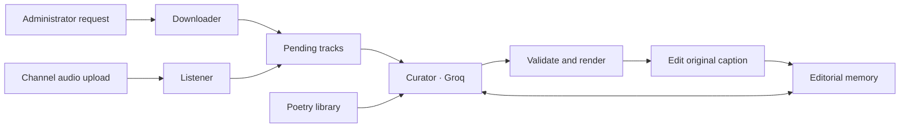

<div align="center">

# Poetic Vibe Curator

### A little literature. A better music channel.

A serverless Telegram agent that gives music a few well-chosen words.<br>
Persian and English captions. An attributed poetry library. Memory that carries forward.

[](https://github.com/salman0H/telegram-vibe-agent/actions/workflows/tests.yml)


[The experience](#the-experience) · [Inside the agent](#inside-the-agent) · [Quick start](#quick-start) · [Development](#development)

</div>

---

Music already tells a story. The caption should leave room for it.

Poetic Vibe Curator accepts an administrator's music requests, watches channel uploads, and adds a short original sentence to the existing audio post. It draws inspiration from Persian and English poetry, remembers its published writing, and checks new candidates for repetition before they reach the channel.

No always-on server or external database. Python's standard library handles the agent; GitHub Actions provides the runners and Git preserves its editorial memory.

## The experience

> **“A small window keeps the afternoon folded.”**
>
> *An illustrative caption: one sentence, a concrete image, room to listen.*

| What arrives | What the agent does |
| :--- | :--- |
| An audio post with no caption | Writes one short poetic sentence, bold and quoted, ending in a period |
| A caption you wrote yourself | Keeps your text and appends 3–4 hashtags if it contains no `#` |
| A nonempty caption already containing `#` | Leaves the post as it is |
| Forwarded Telegram Audio | Reuses its `file_id` and publishes it without downloading the file again |
| A music search from the administrator | Searches with `yt-dlp`, extracts MP3 audio, and uploads it |

Iranian/Persian music receives Persian writing; international music receives English writing. Persian hashtag generation includes 1–2 Persian tags. Empty captions receive a sentence only, without automatically adding hashtags.

The generated copy stays minimal: no emoji, artist names, song titles, or introductory commentary. The curator edits the original audio message, keeping the channel free of extra caption posts.

## Creativity with a memory

A different random instruction is only a starting point. This agent also remembers what it has used.

| Layer | How it keeps the writing moving |
| :--- | :--- |
| **Structure** | Rotates eight sentence structures and eight imagery lenses, excluding choices from the last three successful captions |
| **Context** | Includes the latest 12 successful captions in the prompt to discourage familiar openings, images, and metaphors |
| **Inspiration** | Selects unused poetry excerpts, favors recently absent authors, and considers theme words matching track metadata |
| **Exact history** | Keeps permanent caption fingerprints after normalizing punctuation, HTML entities, diacritics, Persian letter variants, and half-spaces |
| **Similarity checks** | Compares candidates with the latest 100 captions and pending edits for similar wording, word overlap, and repeated three-word openings |
| **Revision** | Allows up to three generation attempts with rejection feedback; unacceptable results remain queued |

The model receives artist/title metadata and an optional iTunes genre. It does not listen to the audio. Language and mood interpretation can be imperfect, and lexical similarity checks cannot guarantee that every metaphor is semantically new. Editorial history begins with this version's first run; old channel captions are not reconstructed.

## A small library, carefully credited

**48 excerpts · 24 Persian · 24 English · 7 poets**

| Persian voices | English voices |
| :--- | :--- |
| Hafez · Saadi · Rumi | Emily Dickinson · William Shakespeare · Edgar Allan Poe · William Blake |

The library lives in [`data/poetry.json`](data/poetry.json). Every excerpt carries a stable ID, language, author, work, original text, source URL, themes, and a rights note. It uses historical public-domain originals, with Persian texts linked to [Ganjoor](https://ganjoor.net/) and English texts linked to the [Poetry Foundation](https://www.poetryfoundation.org/poems).

These poems provide inspiration for original captions. The selected poet is recorded in memory; generated writing is never presented as that poet's quotation or signed with their name. The prompt prohibits copying source wording and signature images, and the validator rejects full copied excerpts.

An excerpt is reserved before an edit and marked used after success. Used IDs never expire. When a language's collection runs out, the agent continues writing independently instead of recycling the library. Different excerpts from the same work have separate IDs.

<details>
<summary><strong>Adding more poetry</strong></summary>

Add entries with the following fields:

| Field | Purpose |
| :--- | :--- |
| `id` | A new, stable excerpt identifier |
| `language` | `fa` or `en` |
| `author`, `work` | Verified poet and original work |
| `text` | The original-language excerpt |
| `source` | A direct link to its source |
| `themes` | Editorial tags for selection and prompt context |
| `rights` | An original-text rights note |

Verify the wording, attribution, and reuse rights before adding an entry, then run the offline tests. Keep existing IDs stable: renaming or recycling them defeats usage tracking. Deleting `content_memory.json` resets repetition protection.

</details>

## Your channel's music catalogue

[`data/artists.md`](data/artists.md) is an automatically updated Markdown table: one row per artist credit, with their songs numbered in first-recorded order. When another song by an existing artist is published, its title is appended to that artist's row. Repeated artist/title pairs are ignored, while the same title by a different artist is recorded separately.

The catalogue is updated after a successful bot upload and when either poller receives channel audio, including posts whose captions are already complete. It uses the audio's `performer` and `title` fields; AI caption generation is independent of collection.

[`data/artist_tracks.json`](data/artist_tracks.json) is the persistent source for the generated table. The workflows commit both files alongside the bot state. Names retain their first spelling and order; duplicate checks normalize case, whitespace, Persian/Arabic letter variants, diacritics, and trailing punctuation. Unknown artists, advertising handles, and missing song titles are not guessed. Band names and collaboration credits stay intact, and aliases or English/Persian spellings are not automatically merged.

Existing artist names and song titles were recovered from locally available queue history. This covers the repository's recorded tracks rather than a full Telegram channel archive. Artists with no recoverable title display a dash. Recorded order reflects when metadata was first observed; it is not a verified chronology of every historical channel post.

To refresh the catalogue from the current queue:

```sh
python3 scripts/artist_registry.py
```

To also recover songs from complete historical queue snapshots in the local clone:

```sh
python3 scripts/artist_registry.py --from-git-history
```

Both commands are idempotent and never contact Telegram. The old `artists.txt` format is supported for migration when no JSON catalogue exists. Edit the JSON source if needed; direct edits to the generated Markdown table are replaced on the next refresh. Save the source and table together while Actions are idle. If rendering is interrupted, the next refresh rebuilds the table from its saved source.

## Inside the agent



| Component | Responsibility |
| :--- | :--- |
| [`agent_downloader.py`](scripts/agent_downloader.py) | Checks the administrator, handles music searches and forwarded files, publishes audio, and queues it |
| [`music_listener.py`](scripts/music_listener.py) | Polls channel updates, filters audio posts, and deduplicates queued message IDs |
| [`daily_ai_curator.py`](scripts/daily_ai_curator.py) | Uses queued genres or one iTunes lookup per track, requests Groq JSON, and edits accepted captions |
| [`editorial.py`](scripts/editorial.py) | Builds creative briefs, validates candidates, and renders safe Telegram HTML |
| [`content_memory.py`](scripts/content_memory.py) | Tracks source usage, caption history, editorial choices, and pending edits |

Generation uses Groq's `openai/gpt-oss-120b` with [JSON-mode output](https://console.groq.com/docs/structured-outputs). Downloading search results additionally requires `yt-dlp` and FFmpeg, installed by the downloader workflow.

## Quick start

### 1. Prepare your bot

Clone or fork the repository. Add your Telegram bot as a channel administrator with permission to post audio and edit messages. Use Python 3.12 for local development.

### 2. Add repository secrets

Open **Settings → Secrets and variables → Actions** and configure:

| Secret | Purpose |
| :--- | :--- |
| `MUSIC_BOT_TOKEN` | Telegram bot credentials |
| `MUSIC_CHANNEL_ID` | Destination channel |
| `ADMIN_USER_ID` | The sender authorized to submit music requests |
| `GROQ_API_KEY` | Caption generation |

The standalone curator also accepts `TELEGRAM_BOT_TOKEN` and `TELEGRAM_CHANNEL_ID` as fallbacks. Use the `MUSIC_*` pair consistently across workflows. Editorial memory needs no additional secrets; the current implementation uses Groq and plain JSON state, without Gemini or `DB_PASSWORD`.

### 3. Enable the workflows

Enable GitHub Actions and allow repository content writes. All three agent workflows support manual execution through **Run workflow**, as well as their schedules:

| Workflow | UTC | Tehran · UTC+03:30 |
| :--- | :--- | :--- |
| [`bot.yml`](.github/workflows/bot.yml) | Every three hours from 00:00 | Every three hours from 03:30 |
| [`listener.yml`](.github/workflows/listener.yml) | 04:00 · 10:00 · 16:00 · 22:00 | 01:30 · 07:30 · 13:30 · 19:30 |
| [`curator.yml`](.github/workflows/curator.yml) | 04:30 · 10:30 · 16:30 · 22:30 | 02:00 · 08:00 · 14:00 · 20:00 |

The downloader also invokes the curator after processing requests. GitHub cron runs can be delayed. The listener and downloader use the existing Telegram `getUpdates` polling arrangement; avoid attaching another update consumer or webhook to the same bot.

## Long tracks, clear limits

There is no three-minute playback limit in the code or workflow. File size and the transfer method determine what can be processed.

| Input | Transfer path | Relevant limit |
| :--- | :--- | :--- |
| **Telegram Audio** | Reuse the existing `file_id` | No `getFile` download; Telegram documents no size limit for resending files this way |
| **Document / Voice** | Download, then upload through the existing path | Telegram cloud downloads are limited to 20 MB; oversized items get a specific status message |
| **Text search** | `yt-dlp` download → MP3 → Telegram upload | The configured input-download cap is `45M`; new multipart uploads face Telegram's 50 MB limit |

Telegram file IDs cannot be resent as a different media type. Send music as **Audio** to use direct reuse. See Telegram's [file transfer rules](https://core.telegram.org/bots/api#sending-files) and [getFile documentation](https://core.telegram.org/bots/api#getfile).

Logs include the received media type, duration when available, byte size, and Telegram download error descriptions. A request skipped by an earlier run must be sent again; old updates are not automatically replayed. The 180-second upload timeout measures request time, not track length.

## State that survives the next runner

Before a caption edit, the curator atomically saves the proposed caption and source reservation. If Telegram fails or its response is lost, the next run retries the same caption on the same message. A “message is not modified” response counts as success. Usage is saved before the track leaves the queue.

All three state-writing workflows share the `music-agent-state` concurrency group. Curator and downloader persistence steps run even after an earlier failure, and Git synchronization failures remain visible.

<details>
<summary><strong>State files, recovery, and operational boundaries</strong></summary>

| File | Stores |
| :--- | :--- |
| `data/artist_tracks.json` | Artist credits and ordered unique song titles |
| `data/artists.md` | Generated artist/song Markdown table |
| `state.json` | Downloader update cursor |
| `music_state.json` | Listener update cursor |
| `daily_log.json` | Tracks awaiting curation |
| `content_memory.json` | Used excerpt IDs, caption fingerprints, recent writing, and pending edits; created on first accepted generation |

- Oversized captions stay queued, preserving manual text and HTML integrity.
- Malformed memory stops curation. Restore the latest valid version from Git instead of resetting its history.
- Writes use a temporary file and atomic replacement. A runner lost before its final Git commit can still lose local changes; Git-backed state is not a transactional database.
- GitHub can replace a pending run in the shared concurrency group when another queues. The next run works from the persisted queue.
- State is plain JSON and contains channel metadata and generated text. Anyone with repository access can read it. Keep credentials in GitHub Secrets.
- Run local state-mutating scripts only when Actions are idle. The polling arrangement does not recover channel history.

</details>

## Development

Run the offline checks from the repository root:

```sh
python3 -m unittest discover -s tests -v
python3 -m compileall -q scripts tests
```

Tests mock Groq and Telegram. Coverage includes poetry exhaustion, Persian normalization, exact and near duplicates, pending reservations, bounded retries, caption validation, manual-text preservation, crash recovery, large forwarded audio without local downloads, and persistent artist/song collection, ordering, deduplication, and safe Markdown rendering from both ingestion paths. They publish nothing to the channel. The [checks workflow](.github/workflows/tests.yml) runs on relevant pushes and pull requests.

<details>
<summary><strong>Running against a real channel</strong></summary>

Set the appropriate environment variables, then run from the repository root:

```sh
python3 scripts/music_listener.py
python3 scripts/daily_ai_curator.py
```

The curator performs real Telegram edits. Use the offline test suite for routine development.

</details>

---

<div align="center">

*Good music deserves a caption that knows when to stop.*

</div>
